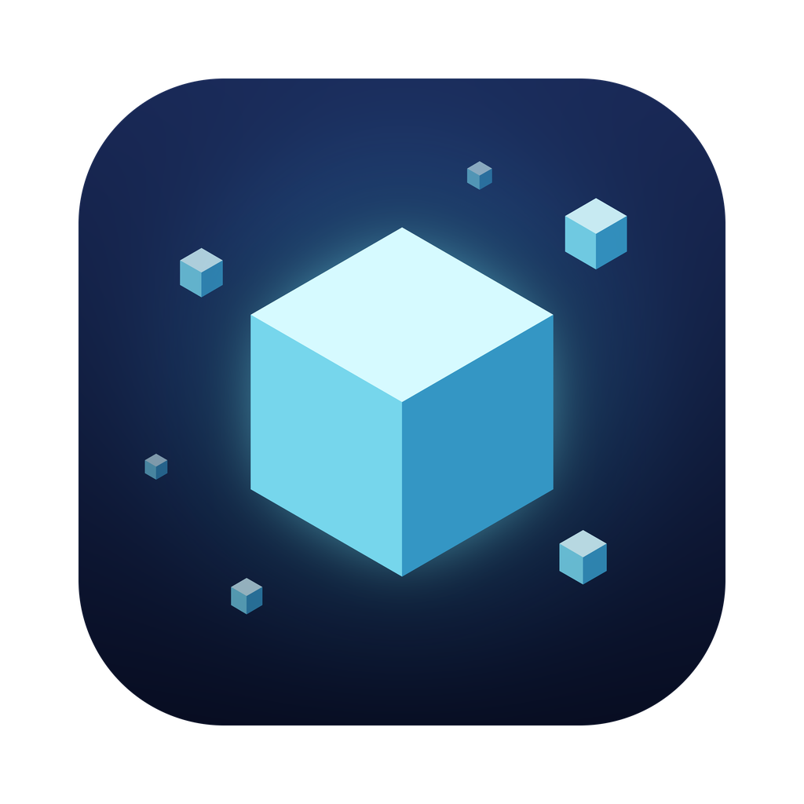

<p align="center"></p>

# Rok

Rok is a voxel editor. It can open and save .vox files.


## Goals

- **Easy to learn and use** Rok shouldn't drown you in buttons like many other 3D programs.
- **Standalone.** Rok needs no other 3D program to run, to build or to test.
- **Permissive licences only.** The Rust crates must pass
  `cargo deny check licenses` (see `native/deny.toml`).

## Status

Rok edits voxel models and scenes, and animates them.

- Edit models with Attach, Erase, Paint and Select in every mode (Voxel, Face,
  Box, Line, Center, Marquee, Lasso, Pattern), with mirror, brush size, the
  height stage and hollow primitives. Among the primitives, the Buckyball is a
  ball of 32 flat faces, and the Framed Buckyball adds raised bars on its edges
  in a darker shade: cut it in half for a faceted canopy.
- Selection, clipboard, the gizmo, the section plane, and every whole-model
  operation (flip, rotate, resize, grow, shrink, hollow, bevel, smooth, loop,
  lathe, twist and more), each with its dialog. Model > Cage puts a lattice of
  points on the selection; drag a point and the real voxels bend. Model >
  Crease finds the flat faces of any shape and raises bars in the current
  colour on the sharp edges between them; the dialog shows the bars live.
- The scene: several models, pick, move, copy, drop, turn by any angle,
  stretch, cut, merge, layers, Add From File, heightmaps and terrain.
- Rok's own UI: the rail, the palette strip and colour popup, the star (Space),
  the command palette (Cmd+K), the hint line and the macOS menu bar.
- Shaders in the xs format (Shaders menu): Rok's own set of 47 runs on the GPU.
- View > View Settings opens a panel beside the model that sets how the
  editing view looks. Every change shows at once. View > Render Settings opens
  the same panel for the file's light, used by the path-traced view and
  File > Render Picture: a preset to
  start from, up to four lights (drag them on the light dome), the sky, the
  ground and the finish. The file keeps its light, also a `.vox` (in a chunk
  that other programs skip).
- File > Export Mesh writes GLB, OBJ or PLY for game engines. "Merge faces" joins neighbouring faces of one colour into rectangles (3 to 10 times fewer triangles); a GLB merges by default, OBJ and PLY keep one quad per voxel face. File > Export Animation has the same option for glTF.
- File > Export Animation writes the clips as glTF (parts that turn, or
  every frame baked as voxels), as a `.vox` with frames, as a
  sprite sheet with Aseprite JSON, as a GIF, or as an MP4 (needs ffmpeg:
  `brew install ffmpeg`).


## Layout

| Folder | What it holds |
|---|---|
| `rok/core/` | The voxel core in Python and numpy: grids, edits, selection, undo, animation, `.vox` read and write, and the UI layout maths |
| `rok/app/` | The app: a small kit (`opkit`, `view3d`, `gfx`, `dialog`) and the editor modules (`tools`, `mode`, `overlay`, `chrome`, `model_ops`, `scene_tools`, `xs_ops` and the rest) |
| `rok/shaders/` | Rok's shader set in the xs format (`.txt` files) |
| `native/` | The Rust crate `rok_native`: the app host (window, events, menu bar, dialogs, draw layers, FXAA), the wgpu ray march, the shader runner and the bake. Python loads it with PyO3 |
| `tests/` | pytest for the core, with golden fixtures in `tests/fixtures/` |
| `scripts/` | The check script, fixture makers and icon tools |
| `assets/` | The app icon and the tool icons |
| `launcher/` | `make_rok_app.sh`, which builds a `Rok.app` shortcut into the repo, and `package_app.sh`, which builds a self-contained `Rok.app` |

## Set up

The core needs only Python and numpy:

```sh
uv sync
uv run pytest -q
```

The viewer also needs Rust. Build the native module into its own venv:

```sh
uv venv .venv-rok && uv pip install --python .venv-rok numpy pytest pytest-timeout pytest-xdist
VIRTUAL_ENV=$PWD/.venv-rok uvx maturin develop --release -m native/Cargo.toml
.venv-rok/bin/python -m rok tests/fixtures/bird.vox
```

Keep the symbols in the release build (`strip = "none"`), or macOS refuses to load
the module.

Turn on the checks that run before every push (once per clone):

```sh
git config core.hooksPath .githooks
```

## Run

`.venv-rok/bin/python -m rok [FILE.vox]` starts Rok. `launcher/make_rok_app.sh`
builds `~/Applications/Rok.app`, a shortcut into this repo that does the same.
Code changes show up the next time you start it; a change in `native/` needs
`maturin develop` (see Set up) first.

`manual/index.html` is the user manual: open it in a browser. It explains
the editor chapter by chapter, with screenshots of every part. `scripts/manual_shots.py`
retakes the screenshots by driving the app, and `scripts/manual_images.py` turns them
into the pictures the page shows.

The full list of keys is in `rok/app/keymap_editor.py`. The most used:

- Two fingers orbit; Option + two fingers zoom; Ctrl + two fingers pan; pinch
  zooms. With a mouse, hold a key and move: Ctrl orbits, Cmd pans, Option
  zooms; the wheel zooms. W A S D Q E move the view.
- T Attach, R Erase, G Paint, Z Select; V F B L C M O P pick the mode.
  Option erases, Shift paints. Space opens the star, Cmd+K the command palette.
- Tab switches between the model and the scene (with the Cut tool it turns the
  cutting plane). Esc deselects, then steps out to the scene; Enter steps into
  the picked model.

`scripts/drive.py OUT_DIR [FILE.vox]` runs the real app with scripted events and
saves screenshots, also while the display sleeps.

## Build a self-contained app

`launcher/package_app.sh` builds `dist/Rok.app` and `dist/Rok.zip`. This app
runs on a Mac without the repo, without Homebrew and without a venv. The script
needs uv, Rust and the Xcode command line tools.

The script does these steps:

1. It copies a relocatable CPython 3.14 from uv (a python-build-standalone
   build) into `Contents/Resources/python`. It leaves out Tcl/Tk and tkinter,
   IDLE, turtle, the test suite, pip and ensurepip, the docs data, the headers
   and the static library.
2. It installs numpy into that Python, without numpy's tests.
3. It builds a release wheel of `rok_native` with `maturin build` and installs
   the wheel into that Python. It does not touch `.venv-rok`.
4. It copies `rok/` and `assets/` into `Contents/Resources/app`.
5. It compiles a small launcher, `Contents/MacOS/Rok`, which embeds the
   bundled Python and runs `rok/__main__.py`. The launcher ignores
   `PYTHONPATH` and writes no `.pyc` files, so the signature stays valid.
6. It writes `Info.plist`, signs the app ad hoc and prints the sizes.

The app is about 61 MB, and the zip is about 23 MB. numpy (22 MB) and
libpython (18 MB) are the largest parts.

`dist/Rok.app/Contents/MacOS/Rok [FILE.vox]` starts it from a terminal, and
`Rok run SCRIPT.py` runs a headless script, as `python -m rok run` does. The
app lists `.vox` as a document type, but Rok does not yet handle the open
event from Finder: a double-clicked file starts Rok without the file.
The ad-hoc signature is enough for this Mac. Another Mac needs a Developer ID
signature and notarisation, or the user must allow the app in System Settings.

## Rok for LLMs

Rok runs without a window, and an LLM can build with it through MCP.

- `.venv-rok/bin/python -m rok run SCRIPT.py [FILE.vox]` runs a script with a
  headless `session` (`rok/headless.py`): `session.run("rok.mirror_half", axis="X")`,
  `session.render_png("quad")`, `session.save("out.vox")`.
- The MCP server needs the SDK once: `uv pip install --python .venv-rok/bin/python "mcp>=2.2"`.
  Then add it to Claude Code:
  `claude mcp add rok -- /path/to/rok/.venv-rok/bin/python /path/to/rok/rok/mcp_server.py`
  (the file path, not `-m`: Claude Code starts servers in another folder).
  It has fifteen `rok_` tools. Every edit returns a summary and a picture of four
  views with cell rulers, in which the changed cells are outlined. `rok_deform`
  bends the selection with the cage. `rok_animate` makes parts, keys, motions,
  voxel frames and clips, shows the posed parts at any frames, and exports glTF,
  `.vox`, a sprite sheet, GIF or MP4. `rok_render` makes a path-traced picture
  with the file's light, or with a render preset, and saves it as a PNG. Its camera frames the whole scene
  from a side, or the model places it: `eye` and `target` in cells (a low eye at
  the edge of a landscape looks along the ground), or `azimuth`, `elevation` and
  `distance`, with `fov` for the lens and `low`/`high` for a box to frame.
  `rok_look` takes the same camera arguments. `ground: false` leaves out a
  preset's endless floor.
- `rok_scene` `new` and `open` replace the whole scene and cannot be undone, so
  with unsaved changes they refuse unless `discard` is true. `import` adds the
  models of a `.vox` file to the scene (one undo step). A tool refuses an
  argument it does not have, and a shader run that changes nothing says why.
- When a Rok window is open, the server works in that window: you see every
  change and can undo it. With no window it starts its own headless Rok.
  `ROK_LIVE=never` keeps it headless; `ROK_LIVE=only` insists on the window.
  The window listens on a socket in its config folder that only your user can open.
- The MCP tools open, save, export and render to any path the model names, with
  your user's rights. Connect Rok only to a model you trust with your files.

## Linux headless

The engine and the MCP server run on a Linux machine with no GPU and no
display. The renderer uses a software Vulkan driver (lavapipe; Debian and
Ubuntu: `apt install mesa-vulkan-drivers`). The native module has two feature
flags: `gui` (default: the menu bar and file dialogs, which need GTK on Linux)
and `headless` (neither; file dialogs answer "cancelled"). macOS builds as
before with the default flags.

```
scripts/linux_headless.sh --smoke /tmp/rok.png
```

installs the Python packages, builds with
`uvx maturin develop --release -m native/Cargo.toml --no-default-features --features headless`
(with `VIRTUAL_ENV=$PWD/.venv-rok`), runs pytest, then starts the MCP server
over stdio, builds a small model and renders a picture. Each test has a 120 s
limit (`pytest-timeout`). Tests that open a window need `ROK_GUI_TESTS=1` and
a display. On a software GPU one test is skipped: the first picture after an
in-place edit of the rendered view differs from a full build in a few hundred
pixels.

## Checks

`scripts/check.sh` runs all checks on your machine: undefined names (ruff), a
build of the native module, pytest, `cargo clippy` with warnings as errors, the
licence checks, `cargo audit` and a `gitleaks` scan of the history. The build goes
into a temporary folder and the tests run against it, so they test the Rust code
of the checkout and leave the module in `.venv-rok` alone. pytest runs in
parallel (`pytest-xdist`). The audit fails for a vulnerable, unsound or yanked
crate; `native/.cargo/audit.toml` lists the notices it skips, each with its reason.
Only permissive licences pass: `cargo deny` checks the Rust crates, and
`scripts/check_python_licences.py` checks the Python packages of `uv.lock`
against `scripts/python_licences.toml`. A new Python package needs a line there,
and a push that changes the packages or that file compares every line with PyPI.
The script needs `cargo-deny`, `cargo-audit` and `gitleaks`.

The shader tests need the GPU and `rok_native`; to run the tests alone, use
`.venv-rok/bin/python -m pytest tests` (the uv venv skips them).
`ROK_GUI_TESTS=1` adds the test that opens a real window and drives it through MCP.

`.githooks/pre-push` runs before every push (see Set up): it blocks a tracked
file over 20 MB and a push that adds over 10 MB of binaries, then runs
`scripts/check.sh` and blocks the push when a check fails. It warns when the
history passes 400 MB. Big source assets, renders and previews stay outside git.
There is no check on GitHub.

## Licence

Rok is under the MIT licence (`LICENSE`). `CREDITS.md` names the few pieces
that come from other people's work. A packaged Rok also ships the licence
texts of the libraries it bundles (`THIRD-PARTY-LICENSES.txt`).
